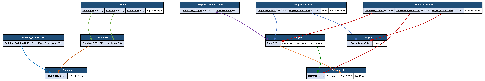
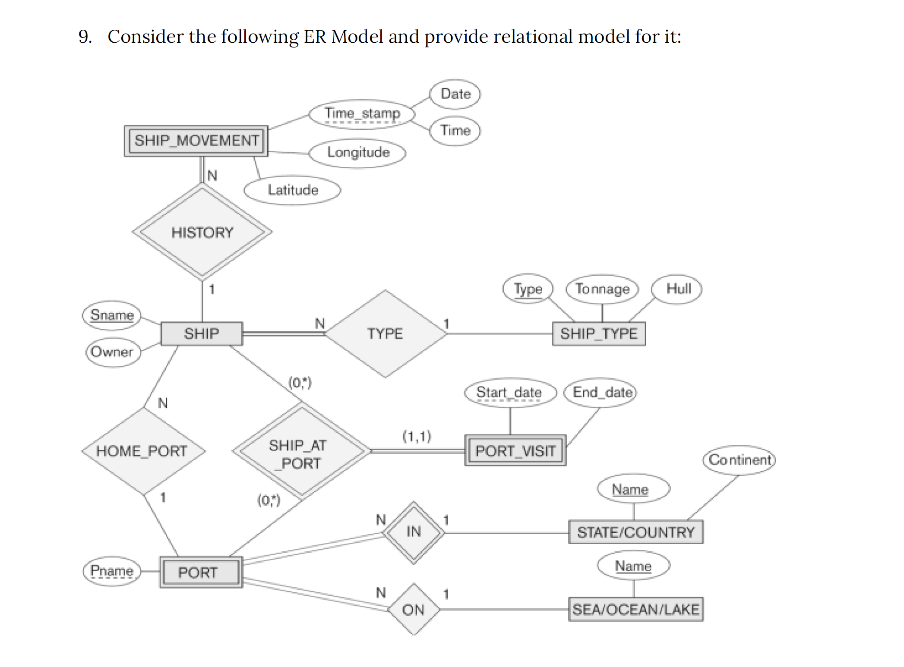
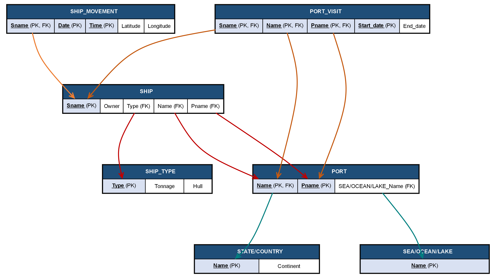

# Part 1: ERD-to-Relational Model Converter & Visualizer — Architecture & User Guide

This module converts an Entity-Relationship Diagram (ERD) specified in JSON format into a formal relational schema and generates a high-resolution visual schema diagram.

## 1. Topological Resolution Order & Dependency Solver

### The Problem: Order of Entity Processing

When mapping an ERD to a relational model, weak entities depend on their strong owner entities to inherit foreign key attributes that make up their composite primary key. In complex schemas, weak entities can be chained in multiple tiers:

$$
\text{STATE/COUNTRY (Strong)} \longrightarrow \text{PORT (Weak Tier 1)} \longrightarrow \text{PORT\_VISIT (Weak Tier 2)}
$$

If the transformer processes `PORT_VISIT` before `PORT` or `PORT` before `STATE/COUNTRY`, it will fail to resolve the required Primary Keys, resulting in incomplete foreign key attributes or runtime errors.

### The Solution: Dependency Graph & Topological Resolution

To guarantee zero-error primary key resolution, `ERTransformer` employs a two-pass dependency resolution algorithm:

1. **Pre-Indexing Phase ($O(R)$ Setup)**:
   The `ERDIndexer` scans all relationships in $O(R)$ time to map identifying relationships and build an adjacency list representing owner-dependent entity dependencies.

2. **Topological Dependency Solver**:
   The engine builds a Directed Acyclic Graph (DAG) where an edge $A \rightarrow B$ indicates that entity $B$ depends on entity $A$'s primary key. Nodes are resolved in topological order:

   * **Stage 1**: Resolve all strong entities ($0$ in-degree dependencies).
   * **Stage 2**: Iteratively resolve level-1 weak entities (`PORT`).
   * **Stage 3**: Resolve level-$N$ chained weak entities (`PORT_VISIT`, `SHIP_MOVEMENT`).
   * **Stage 4**: Resolve relationships ($1:1$, $1:N$, $M:N$, $N$-ary) and extract multivalued attributes.

---

## 2. Multi-Tier Weak Entities & Chained Identifying Relationships

Weak entities inherit keys through chained identifying relationships using `"isIdentifying": true` and `"identifiedByThis": true`.

### Chained Identifying Mapping Rules

* **Owner Identification**: The relationship specifies `isIdentifying: true`. The entity being identified sets `"identifiedByThis": true`.
* **Key Propagation**: The child entity inherits **all Primary Key attributes** of the parent (including any keys the parent inherited from earlier links in the chain) as both Foreign Keys and part of its own composite Primary Key.

#### Example: Multi-Tier Weak Chains (`STATE/COUNTRY` $\rightarrow$ `PORT` $\rightarrow$ `PORT_VISIT`)

1. **`STATE/COUNTRY`**: Strong entity with primary key `Name`.
2. **`PORT`**: Weak entity identified by `STATE/COUNTRY` via relationship `IN`. Partial key `Pname`.
   * **Resulting `PORT` Schema**: `Name` (PK, FK), `Pname` (PK).
3. **`PORT_VISIT`**: Weak entity identified by `SHIP` and `PORT` via relationship `SHIP_AT_PORT`. Partial key `Start_date`.
   * **Resulting `PORT_VISIT` Schema**: `Sname` (PK, FK), `Name` (PK, FK), `Pname` (PK, FK), `Start_date` (PK), `End_date`.

---

## 3. Input Attribute & Relationship Specification Reference

### A. Attribute Reference

| ER Construct | JSON Syntax Example | Relational Mapping Outcome |
| :--- | :--- | :--- |
| **Simple Attribute** | `{"name": "Budget"}` | Standard column in the entity table. |
| **Primary Key (Simple)** | `{"name": "EmpID", "isPrimaryKey": true}` | Underlined as Primary Key (`PK`). |
| **Composite Primary Key** | `{"name": "ID", "isPrimaryKey": true, "composite": ["Code", "Num"]}` | Sub-fields are flattened into individual `PK` columns. |
| **Partial Key (Simple)** | `{"name": "AptNum", "isPartialKey": true}` | Combined with parent `FK`(s) to form a composite `PK`. |
| **Composite Partial Key** | `{"name": "PartID", "isPartialKey": true, "composite": ["Date", "Time"]}` | Sub-fields are flattened into the weak entity's composite `PK`. |
| **Composite Attribute (Non-Key)** | `{"name": "FullName", "composite": ["FirstName", "LastName"]}` | Flattened into standard columns (`FirstName`, `LastName`). |
| **Multivalued Attribute** | `{"name": "Phone", "isMultiValued": true}` | Extracted into a separate table (`Entity_Phone`) with a `FK` referencing the entity's `PK`. |
| **Composite + Multivalued** | `{"name": "Location", "isMultiValued": true, "composite": ["Floor", "Wing"]}` | Extracted into a separate table (`Entity_Location`) with flattened sub-fields and parent `FK`. |

> ⚠️ **Constraint:** Multivalued attributes **cannot be Primary or Partial Keys** in standard ER modeling. They are always extracted into their own table.

### B. Relationship Types Reference

#### 1. Binary $1:1$ Relationship
The Foreign Key and any relationship attributes are embedded into the target or total participation table to avoid unnecessary junction tables.

```json
{
  "name": "Manages",
  "isIdentifying": false,
  "entities": [
    { "eName": "Employee", "cardinality": "1", "participation": "partial" },
    { "eName": "Department", "cardinality": "1", "participation": "total" }
  ],
  "attributes": [{ "name": "StartDate" }]
}
```

#### 2. Binary $1:N$ Relationship
The Foreign Key and any relationship attributes are placed on the $N$-side table pointing to the $1$-side Primary Key.

```json
{
  "name": "WorksIn",
  "isIdentifying": false,
  "entities": [
    { "eName": "Employee", "cardinality": "N", "participation": "total" },
    { "eName": "Department", "cardinality": "1", "participation": "partial" }
  ]
}
```

#### 3. Binary $M:N$ Relationship
Creates a dedicated junction table containing Foreign Keys referencing both participating primary keys.

```json
{
  "name": "AssignedToProject",
  "isIdentifying": false,
  "entities": [
    { "eName": "Employee", "cardinality": "M" },
    { "eName": "Project", "cardinality": "N" }
  ],
  "attributes": [{ "name": "Role" }, { "name": "HoursAllocated" }]
}
```

#### 4. Ternary / $N$-ary Relationship
Creates a dedicated junction table containing Foreign Keys referencing all $N$ participating entities' Primary Keys.

```json
{
  "name": "SupervisesProject",
  "isIdentifying": false,
  "entities": [
    { "eName": "Employee", "cardinality": "N" },
    { "eName": "Department", "cardinality": "N" },
    { "eName": "Project", "cardinality": "N" }
  ],
  "attributes": [{ "name": "OversightNotes" }]
}
```

---


## 4. Standard Test Suites & Output Verification

### Test Suite 1: Standard Building & Project Schema (`test_for_readme.json`)

<details>
<summary><b>Click to expand <code>test_for_readme.json</code></b></summary>

```json
{
  "entities": [
    {
      "name": "Building",
      "isWeak": false,
      "attributes": [
        { "name": "BuildingID", "isPrimaryKey": true },
        { "name": "BuildingName" },
        {
          "name": "OfficeLocation",
          "isMultiValued": true,
          "composite": ["Floor", "Wing"]
        }
      ]
    },
    {
      "name": "Apartment",
      "isWeak": true,
      "attributes": [
        { "name": "AptNum", "isPartialKey": true }
      ]
    },
    {
      "name": "Room",
      "isWeak": true,
      "attributes": [
        { "name": "RoomCode", "isPartialKey": true },
        { "name": "SquareFootage" }
      ]
    },
    {
      "name": "Employee",
      "isWeak": false,
      "attributes": [
        { "name": "EmpID", "isPrimaryKey": true },
        {
          "name": "FullName",
          "composite": ["FirstName", "LastName"]
        },
        { "name": "PhoneNumber", "isMultiValued": true }
      ]
    },
    {
      "name": "Department",
      "isWeak": false,
      "attributes": [
        { "name": "DeptCode", "isPrimaryKey": true },
        { "name": "DeptName" }
      ]
    },
    {
      "name": "Project",
      "isWeak": false,
      "attributes": [
        { "name": "ProjectCode", "isPrimaryKey": true },
        { "name": "Budget" }
      ]
    }
  ],
  "relationships": [
    {
      "name": "HasApartment",
      "isIdentifying": true,
      "entities": [
        { "eName": "Building", "cardinality": "1" },
        { "eName": "Apartment", "cardinality": "N", "identifiedByThis": true }
      ]
    },
    {
      "name": "HasRoom",
      "isIdentifying": true,
      "entities": [
        { "eName": "Apartment", "cardinality": "1" },
        { "eName": "Room", "cardinality": "N", "identifiedByThis": true }
      ]
    },
    {
      "name": "Manages",
      "isIdentifying": false,
      "entities": [
        { "eName": "Employee", "cardinality": "1", "participation": "partial" },
        { "eName": "Department", "cardinality": "1", "participation": "total" }
      ],
      "attributes": [
        { "name": "StartDate" }
      ]
    },
    {
      "name": "WorksIn",
      "isIdentifying": false,
      "entities": [
        { "eName": "Employee", "cardinality": "N", "participation": "total" },
        { "eName": "Department", "cardinality": "1", "participation": "partial" }
      ]
    },
    {
      "name": "AssignedToProject",
      "isIdentifying": false,
      "entities": [
        { "eName": "Employee", "cardinality": "M" },
        { "eName": "Project", "cardinality": "N" }
      ],
      "attributes": [
        { "name": "Role" },
        { "name": "HoursAllocated" }
      ]
    },
    {
      "name": "SupervisesProject",
      "isIdentifying": false,
      "entities": [
        { "eName": "Employee", "cardinality": "N" },
        { "eName": "Department", "cardinality": "N" },
        { "eName": "Project", "cardinality": "N" }
      ],
      "attributes": [
        { "name": "OversightNotes" }
      ]
    }
  ]
}
```
</details>

#### Rendered Relational Diagram Output (`sample_run_for_readme.png`)



---

### Test Suite 2: Ship Tracking Schema (`ship_port_sheet3`)

<details>
<summary><b>Click to expand <code>ship_port_sheet3/input.json</code></b></summary>

```json
{
  "entities": [
    {
      "name": "SHIP",
      "isWeak": false,
      "attributes": [
        { "name": "Sname", "isPrimaryKey": true },
        { "name": "Owner" }
      ]
    },
    {
      "name": "SHIP_TYPE",
      "isWeak": false,
      "attributes": [
        { "name": "Type", "isPrimaryKey": true },
        { "name": "Tonnage" },
        { "name": "Hull" }
      ]
    },
    {
      "name": "SHIP_MOVEMENT",
      "isWeak": true,
      "attributes": [
        {
          "name": "Time_stamp",
          "isPartialKey": true,
          "composite": ["Date", "Time"]
        },
        { "name": "Latitude" },
        { "name": "Longitude" }
      ]
    },
    {
      "name": "PORT",
      "isWeak": true,
      "attributes": [
        { "name": "Pname", "isPartialKey": true }
      ]
    },
    {
      "name": "PORT_VISIT",
      "isWeak": true,
      "attributes": [
        { "name": "Start_date", "isPartialKey": true },
        { "name": "End_date" }
      ]
    },
    {
      "name": "STATE/COUNTRY",
      "isWeak": false,
      "attributes": [
        { "name": "Name", "isPrimaryKey": true },
        { "name": "Continent" }
      ]
    },
    {
      "name": "SEA/OCEAN/LAKE",
      "isWeak": false,
      "attributes": [
        { "name": "Name", "isPrimaryKey": true }
      ]
    }
  ],
  "relationships": [
    {
      "name": "TYPE",
      "isIdentifying": false,
      "entities": [
        { "eName": "SHIP", "cardinality": "N", "participation": "partial" },
        { "eName": "SHIP_TYPE", "cardinality": "1", "participation": "partial" }
      ]
    },
    {
      "name": "HISTORY",
      "isIdentifying": true,
      "entities": [
        { "eName": "SHIP", "cardinality": "1", "participation": "partial" },
        { "eName": "SHIP_MOVEMENT", "cardinality": "N", "identifiedByThis": true, "participation": "total" }
      ]
    },
    {
      "name": "HOME_PORT",
      "isIdentifying": false,
      "entities": [
        { "eName": "SHIP", "cardinality": "N", "participation": "partial" },
        { "eName": "PORT", "cardinality": "1", "participation": "partial" }
      ]
    },
    {
      "name": "SHIP_AT_PORT",
      "isIdentifying": true,
      "entities": [
        { "eName": "SHIP", "cardinality": "M", "participation": "partial" },
        { "eName": "PORT", "cardinality": "N", "participation": "partial" },
        { "eName": "PORT_VISIT", "cardinality": "1", "identifiedByThis": true, "participation": "total" }
      ]
    },
    {
      "name": "IN",
      "isIdentifying": true,
      "entities": [
        { "eName": "PORT", "cardinality": "N", "participation": "full" },
        { "eName": "STATE/COUNTRY", "cardinality": "1", "participation": "partial" }
      ]
    },
    {
      "name": "ON",
      "isIdentifying": false,
      "entities": [
        { "eName": "PORT", "cardinality": "N", "participation": "partial" },
        { "eName": "SEA/OCEAN/LAKE", "cardinality": "1", "participation": "partial" }
      ]
    }
  ]
}
```
</details>

#### ERD Input Question (`sheet_question.png`) vs Rendered Output (`output.png`)

| Source ERD Diagram | Generated Relational Model Output |
| :---: | :---: |
|  |  |